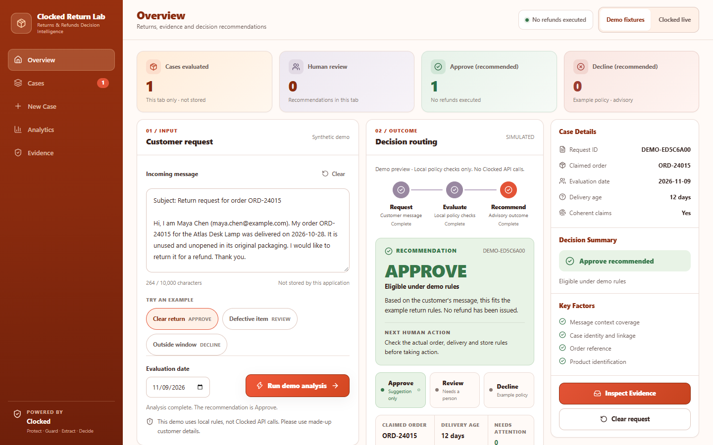

# Judges' guide — Clocked Return Lab

**The problem:** Unstructured customer return emails contain missing dates, conflicting details and exceptions. Support agents need the evidence behind a recommendation, not unexplained model certainty.

**The solution:** Clocked Return Lab presents three advisory lanes—Approve, Human Review or Decline—with traceable source evidence, typed assessments and transparent local policy checks. It never executes refunds.

## Start here: narrated demo

**[Watch the latest Tuscan Sunset walkthrough (~101 seconds)](https://github.com/Cho3en/clocked-returns-refund-autopilot/releases/download/demo-v6/clocked-return-lab-narrated-demo.mp4)**

The video runs real application UI against **synthetic demo fixtures, with no paid Clocked calls**:

1. An unused return inside the illustrative 30-day window → provisional Approve.
2. A defective item with incomplete information → Human Review.
3. A customer-reported delivery 58 days ago → provisional Decline under the example policy.

All three outcomes remain subject to merchant verification, customer rights and human judgment.

## Where Clocked is integrated

**[lib/pipeline.ts](lib/pipeline.ts)** is the actual JavaScript SDK orchestration (not a fake API adapter).

| Endpoint | Contribution |
|---|---|
| Protect (pii) | Best-effort personal-data masking before downstream analysis |
| Guard (injection) | Injection risk screening; blocks or abstains before Extract/Decide if unsafe or uncertain |
| Extract (extract) | Reported fields and exact source offsets, validated locally |
| Decide (decide) | Typed probabilities for intent, item condition and defect concerns |
| Local policy | Checks scope, coherence and exceptions before recommending a lane |

The newest live implementation was not revalidated with paid provider calls after its safety updates. An [older real-API demo](https://github.com/Cho3en/clocked-returns-refund-autopilot/releases/download/demo-v1/clocked-return-lab-live-demo.webm) is provided as historical evidence only.

## Run the product

    npm ci
    npm run dev

Open http://localhost:3000 and leave **Demo fixtures** selected. Three buttons reproduce the complete journey without credentials or paid calls.

Review the Source-linked extraction, Case linkage & intent, Typed assessments, and Policy & safety gates panels. They distinguish stated claims from independent verification.

## Engineering record and limitations

- **918 passing local automated unit tests**, plus security, browser, and adversarial suites.
- Guard uncertainty prevents downstream calls. Unknown demo products, contradictory claims and safety problems route to a person.
- No actual order or catalog verification, legal rulings, payment or refund execution, shared billing cap, or current-version live-provider accuracy claim.

[README](README.md) · [Submission copy](SUBMISSION.md) · [Historical audits](docs/archive/) · [Official rules](https://clocked.rezolve.ai/build-challenge/rules)
