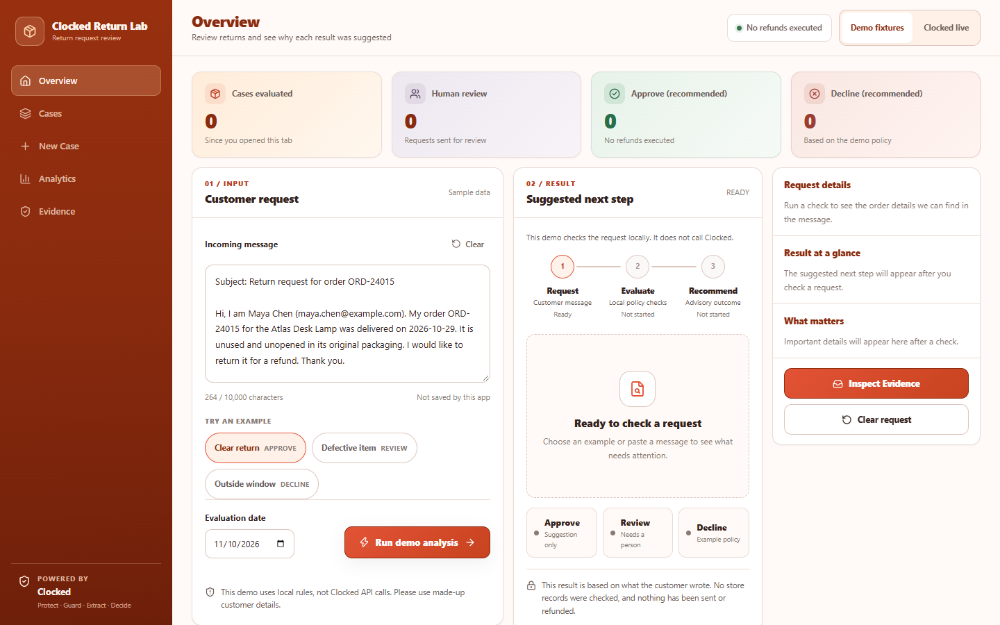

# Clocked Return Lab

**A simpler way to review customer return requests.**

A return email can look straightforward until you read it carefully. Maybe the customer forgot to mention when the item arrived. Maybe they have two orders. Maybe the item is defective, so the usual return policy is not the whole story.

Clocked Return Lab helps a support agent sort through those details. It reads the request, identifies what the customer is claiming, and suggests whether to Approve, ask for Human Review, or Decline under a sample policy. The agent can then inspect the reasons and the exact text behind them.

It is a prototype for reviewing cases, not a refund processing system. **It does not confirm orders, send messages, charge customers, or issue refunds.**

[Watch the narrated demo](https://github.com/Cho3en/Clocked-Return-Lab/releases/download/demo-v6/clocked-return-lab-narrated-demo.mp4) | [Start here if you're judging](JUDGES_START_HERE.md) | [Submission details](SUBMISSION.md)



## Try the three example requests

Each example shows how the app handles a different type of return. You can run all three without an API key.

| Example | Suggested result | Why |
|---|---|---|
| Clear return | Approve | The customer reports an unused item within the example 30-day window. |
| Defective item | Human Review | A product problem needs a person to check the details. |
| Outside window | Decline | The reported delivery date falls outside the example window. A person still needs to check customer rights. |

[See an approval](assets/approved.png) | [See a case sent for review](assets/review.png) | [See a decline](assets/declined.png)

These are example recommendations, not final decisions or refunds.

## What you can do

- Paste in a return request or select one of the three example messages.
- See the suggested next step and what information is missing.
- Open the evidence panels to check which words in the message led to each finding.
- See which policy or safety checks passed and which ones need a person to investigate.

The demo uses a small, made-up product list and an example 30-day policy. These are not real merchant records, and the customer's statements have not been independently verified.

## How Clocked is used

The live version connects to four Clocked services:

| Service | What it does |
|---|---|
| Protect | Masks personal information before the message goes to the next service. Masking may not catch everything. |
| Guard | Checks for prompt injection and can stop an unsafe or uncertain request. |
| Extract | Finds details such as order numbers, dates, and item condition, along with their positions in the original text. |
| Decide | Assesses specific questions about the request, such as whether the customer is asking for a refund or reporting a defect. |

After those calls, our own policy checks determine which recommendation to show. Missing information, conflicting claims, and product or safety problems can send a case to a person for review.

You can inspect the [Clocked integration](lib/pipeline.ts), [field handling](lib/evidence.ts), and [policy checks](lib/policy.ts).

## Try it on your computer

You'll need Node.js 22 or newer and npm.

```bash
git clone https://github.com/Cho3en/Clocked-Return-Lab.git
cd Clocked-Return-Lab
npm ci
npm run dev
```

Open http://localhost:3000 and leave **Demo fixtures** selected. Try Clear return, Defective item, and Outside window.

You don't need a Clocked account to run those examples. They use local rules and synthetic customer data.

If you want to test the live integration, copy `.env.example` to `.env.local`. Add your server-side `CLOCKED_API_KEY` and a separate `RETURNLAB_ACCESS_TOKEN` of at least 32 characters. Enter only the access token in the browser.

Live mode stays switched off until you also set four operator values in `.env.local`:

| Variable | Purpose |
|---|---|
| `RETURNLAB_LIVE_ENABLED=YES` | Turns paid live analysis on. Anything else keeps it off. |
| `CLOCKED_ROTATED_KEY_CONFIRMED=YES` | Confirms the key was rotated after the earlier exposure. The app cannot check this itself. |
| `CLOCKED_PROVIDER_HARD_CAP_CONFIRMED=YES` | Confirms a hard spending limit exists in the Clocked account. |
| `CLOCKED_PROVIDER_HARD_CAP_USD` | The attested limit. It must be 0.05 or lower. |

Without all four, the server answers with a plain "not enabled" message and never calls Clocked. Live requests can use paid credits, so check your account limits first.

## What has been tested

The current release passed 970 unit and regression tests, the TypeScript check, linting, and a production build. Browser tests covered desktop and mobile layouts, keyboard access, navigation, the three demo outcomes, input changes, and evidence inspection.

We also ran 22 security checks and several sets of synthetic adversarial cases, including a fresh batch written after the latest fixes. The production dependency audit reported no vulnerabilities on November 9, 2026. These checks help catch bugs, but they don't prove that every possible request will be handled correctly.

The repository also passes from a fresh clone with no private configuration. Demo mode needs no key, and live mode reports that it is not configured instead of failing a security check.

**We have not rerun paid Clocked calls against the latest version.** An [older live recording](https://github.com/Cho3en/Clocked-Return-Lab/releases/tag/demo-v1) shows real calls from an earlier build, not a verification of this release.

The screenshots in this README and the judges' guide were captured from the current build on November 10, 2026.

There is no connection to a store database, shipping provider, payment system, or live product catalog. There is also no persistent case history or shared spending cap. The app has mainly been tested with English requests and should not be used with real customer information in demo mode.

## Challenge entry

This project was made for the [Clocked Build Challenge](https://clocked.rezolve.ai/challenge). The announced deadline is November 10, 2026, at 11:59 p.m. Eastern (November 11 at 05:59 in Zagreb).

The code and demo are public, but the entry must still be submitted through the official challenge form.

[Judges' guide](JUDGES_START_HERE.md) | [Prepared entry answers](ENTRY_FORM_COPY.md) | [Test report](docs/FINAL_RELEASE_AUDIT.md)
